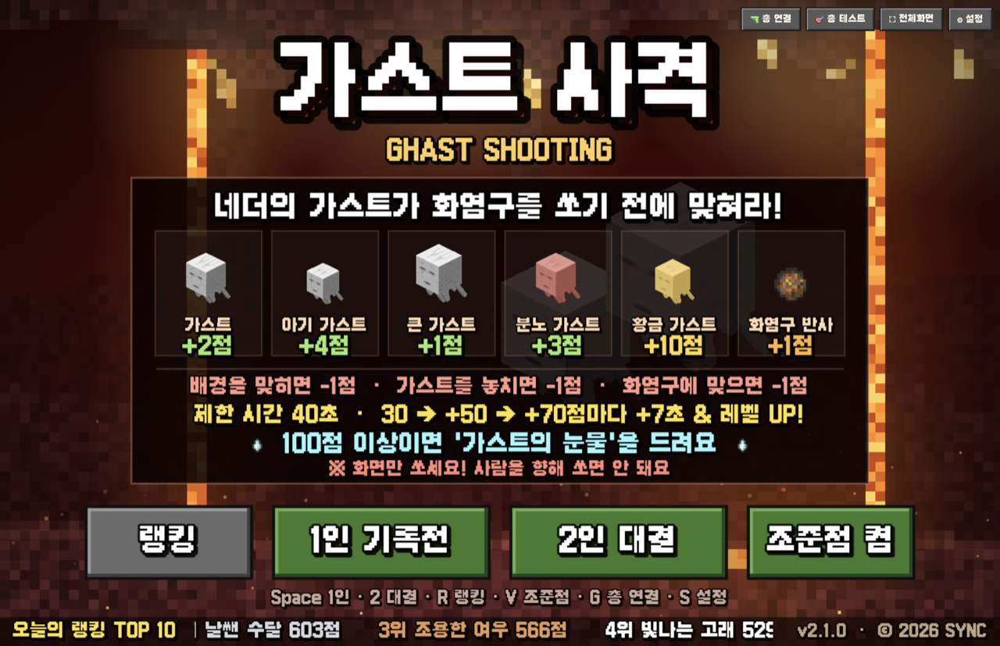

# 🔥 가스트 사격 (Ghast Shooting)

> **🧪 v3 (다음 버전, 시험 중)** — 다음 버전 3.0.x 를 시험하고 있습니다(지금 3.0.6, 고칠 때마다 3.0.5 → 3.0.6 …). 지금 운영 중인 **v2.2.10 은 그대로** 둡니다.
> - 앱 이름이 따로입니다: **가스트 사격 3** (맥은 `Ghast Shooting 3.app`). v2.2.7(**가스트 사격** / `Ghast Shooting.app`) 옆에 따로 설치되어 둘 다 쓸 수 있습니다.
> - 설정·명단·총 보정도 따로 저장됩니다 (`가스트 사격 3` 폴더). 처음 켜면 **명단 CSV 를 한 번 다시 불러오고, 총 보정을 한 번 다시** 하세요.
> - 온라인(브라우저) 버전과 랭킹 서버는 아직 바뀌지 않았습니다.

### v3.0.6 바뀐 점
- **랭킹 서버 보안** (운영판 v2.2.10 과 같은 서버): 한 판 최대 길이 600초로 점수 상한(미리 받아 둔 표를 묵혀 큰 점수를 올리지 못하게), 표 사용·기록 저장을 한 번에(실패하면 함께 취소), 이름의 안 보이는 글자 제거, 관리자 키 시도 1분 20번 제한
- **익명 경기 기록**: 1인 기록전 기록을 올릴 때 판 길이·쏜 수·처치·반사·피격·빈 곳·놓침·레벨을 이름 없이 함께 저장 (밸런스 조정용)
- **공개 웹판**: 점수에 영향을 주는 설정(제한 시간·보너스·점수·감점·빠르기·판정 범위·가스트 크기)을 바꾼 판은 랭킹에 올리지 않음 (앱·행사 PC 는 그대로)

### v3.0.5 바뀐 점
- **대회 관리 창** (대진표·순위표·우승 화면의 오른쪽 위 [대회 관리] 또는 **K** 키, 진행요원용이라 마우스·키보드로만):
  - **이름 고치기**: 대회 중에도 오타를 고칠 수 있습니다 (같은 이름·빈 이름은 안 됨)
  - **기권**: 토너먼트는 상대가 경기 없이 올라갑니다 (준결승 기권자가 나오는 3·4위전도 상대가 저절로 3위). 리그전은 그 사람의 남은 경기가 모두 기권 0점, 상대는 그때까지의 한 판 평균 점수를 받습니다 (최고 한 판 점수에는 안 들어감). 대진표의 [결과 취소]로 되돌릴 수 있고, 리그 기권은 한 번에 되돌아갑니다
  - **결과 저장**: 순위·경기별 점수를 CSV 파일로 저장 (엑셀에서 바로 열림)
- 게임이 그림을 먼저 다 읽으면 뒤쪽 스크립트를 읽기 전에 시작하던 문제를 고침 (시작할 때 나던 콘솔 오류 2개도 사라짐)

### v3.0.4 바뀐 점
- **2인 대결·대회 방아쇠 공정성**: 2P(보통 총)는 방아쇠가 25~50ms 늦게 들어와서, 경기 중에는 1P(Pro) 방아쇠도 '다음 25ms 칸 + 25ms'(25~50ms) 뒤에 처리합니다. 접시 사격에서 잰 값(보정 뒤 동시 당김 63쌍 평균 차이 −6.4ms) 그대로. 1인 기록전·메뉴는 바로 처리 (운영판 v2.2.9 에도 같이 넣음)
- **연사 차단 알림**: 연사(Rapid Fire)가 감지돼 총이 1.5초 잠기면 그 자리에 '연사 금지!'와 안내를 띄웁니다 (예전에는 조용히 무시해서 왜 안 맞는지 알 수 없었음)
- **수신기가 처음부터 없을 때 안내**: 앱을 켰는데 수신기가 꽂혀 있지 않으면 처음 화면 위에 "○P 총 수신기가 꽂혀 있지 않아요" (1인 기록전 화면은 수신기가 하나도 없을 때만)

### v3.0.3 바뀐 점
- 맥에서 총이 켜져 있는데 게임에 안 잡히면 **입력 모니터링 권한** 안내: 엑스거너 수신기에는 키보드 기능이 있어 맥은 이 권한이 있는 앱에만 총 장치를 엽니다. v3 는 정식 개발자 서명이 없어 **새 빌드를 설치할 때마다** 시스템 설정 → 개인정보 보호 및 보안 → 입력 모니터링에서 'Ghast Shooting 3' 을 지웠다가 다시 추가해 켜야 할 수 있습니다 (2026-11-19 실측: 권한을 다시 주자 두 총 모두 인식)

### v3.0.2 바뀐 점
- 총 모드 자동 전환을 게임과 분리된 작은 Node 프로세스로: 시리얼 부품 오류(예: 두 앱이 같은 수신기 포트를 동시에 씀)가 나도 게임은 꺼지지 않고, 자동 전환만 3초 뒤 다시 켜짐. 수신기 시리얼이 멈추면(포트를 연 채 앱이 강제 종료된 뒤 등) 3초 만에 포기하고 "○P 수신기가 응답하지 않아요 — 뽑았다가 다시 꽂으세요" 안내

### v3.0.1 바뀐 점
- 총 모드 자동 전환(앱), 꺼진 총 경고, 엑스거너 수신기 번호로 1P·2P 자동 지정, 꺼진 총·마우스 조준점 안 그림, 다른 화면으로 바꿔도 게임으로 되돌아가지 않음 (아래 목록에 자세히)

### v3.0.0 바뀐 점
- **새 앱 '가스트 사격 3'과 새 아이콘**: v2.2.7 옆에 따로 설치되고 설정·명단·총 보정도 따로 저장합니다.
- **대회 운영**: [결과 취소]로 마지막 경기 결과를 되돌려 다시 할 수 있습니다. 새 대회를 만들기 전에 지난 대회를 자동으로 백업합니다. 위험한 확인(새 대회·결과 취소·기록 삭제)은 총(조이스틱 모드)으로 누를 수 없습니다.
- **2인 경기 중 총이 빠지면** 자동으로 일시정지하고 알려 줍니다.
- **총 연결 처리 (실제 총 시험 반영)**: 엑스거너 수신기 번호로 1P·2P 자동 지정(뒤바뀜 방지), 꺼진 총(수신기만 꽂힘)의 조준점을 그리지 않음, 게임 중 마우스 조준점 숨김(조준점 3개 문제), 화면 맨 위 총 상태 띠(빠짐·신호 없음), 총 연결 화면에 빠른 총(Pro)·보통 총 표시.
- **다른 화면으로 바꿔도 게임으로 되돌아가지 않음** (전체화면 포커스 되찾기 제거).
- **총 모드 자동 전환 (앱만, 설정에서 끌 수 있음)**: 엑스거너 총은 켤 때마다 마우스 모드로 시작합니다. 앱이 3초마다 수신기 시리얼로 총이 켜졌는지 묻고(`XQ;`), 막 켜진 총에는 게임패드 모드 명령(`J`)을 보냅니다. 켜져 있는데 게임패드 신호가 안 들어오면 8초마다 다시(최대 3번), 그래도 안 되면 "Space + 5 + 조이스틱 왼쪽" 안내. 꺼진 총에는 보내지 않고 "○P 총이 꺼져 있어요"로 알립니다. 다른 프로그램이 수신기 포트를 쓰면 건너뜁니다. 웹 버전은 지금처럼 직접 전환합니다. 총 전원을 껐다 켜면 총은 다시 마우스 모드입니다(다른 프로그램에서 마우스로 쓸 때 참고).
- **상품 고정**: 판 도중 한 번이라도 기준을 넘으면 끝 점수가 내려가도 가스트의 눈물을 받습니다.
- **늦은 탄 감점 없음**: 상대가 한발 먼저 맞힌 가스트를 쏜 탄은 빗나감 감점 대신 '늦었어요'만 뜹니다.
- **이름 쏘기 판**: Q·Esc 는 [건너뛰기]와 같습니다(기록 유지). 총의 S 키로 설정 창이 뜨지 않습니다. 글자판과 아래 버튼 사이를 띄웠습니다.
- **랭킹**: 요청마다 8초 시간 제한, 5일 넘은 예비 표 자동 교체, 이름의 보이지 않는 글자 정리.
- **화면**: 가스트 종류별 크기가 겹치지 않습니다(평균 크기는 예전과 같아 랭킹 난이도 동일). 점수판 바탕을 진하게 했습니다. 피격 번쩍임을 약하게 하고 0.4초 안에는 다시 번쩍이지 않습니다. '놓침' 글자가 화면 밖으로 잘리지 않습니다. 결과 화면에 경기 막판 안내가 겹치지 않습니다. 1인 기록전 글자를 키우고, 확인 창·2인 이름 창 버튼을 화면 크기에 맞춰 크게 했으며, 선택된 버튼에 금색 테두리를 넣었습니다.
- **소리·화질**: 화염구 충전 소리를 키웠습니다. 자동 화질 낮춤은 그 실행에서만 적용합니다.
- **앱 안정성**: 화면 오류 시 자동으로 다시 열기, 두 번 켜기 막기, 숨김 파일 접근 차단.
- **빌드**: 빌드 전에 자동 테스트를 실행하고, 앱에 빠진 파일이 없는지 검사합니다.
- **그대로인 것**: 웹 버전과 랭킹 서버는 v2.2.7 그대로입니다(같은 랭킹에 기록). 점수 규칙도 바꾸지 않았습니다.

[](https://github.com/mg223080612-a11y/ghast/releases/latest)


> 네더에 나타난 가스트가 화염구를 쏘기 전에 라이트건으로 맞혀라!
> 학교 행사용 프로젝터 + 라이트건 사격 게임. 1인 기록전(온라인 랭킹)·2인 대결·대회 모드(토너먼트·리그전)를 지원합니다.
>
> **만든 사람: 정다희** — 처음 화면 제목 아래와 맨 아래 띠에 표시됩니다.



## 📥 다운로드 · 플레이

| 플랫폼 | 받을 파일 / 주소 | 받는 곳 | 비고 |
|---|---|---|---|
| 🌐 **온라인 (브라우저)** | https://ghast-shooting.gcinhak.workers.dev | [▶ 바로 플레이](https://ghast-shooting.gcinhak.workers.dev) | 설치 없음. Chrome 권장, **F** 로 전체화면 |
| 🪟 **Windows** (설치형) | `ghast-shooting-2.2.7-setup.exe` | [⬇ 최신 릴리스](https://github.com/mg223080612-a11y/ghast/releases/latest) | 설치하면 바탕화면에 **가스트 사격** 아이콘 |
| 🪟 **Windows** (휴대용) | `ghast-shooting-2.2.7-portable.exe` | [⬇ 최신 릴리스](https://github.com/mg223080612-a11y/ghast/releases/latest) | 설치 없이 파일 하나로 실행 (USB 용) |
| 🍎 **macOS** (애플 실리콘 M1~M4) | `ghast-shooting-2.2.7-mac-arm64.zip` | [⬇ 최신 릴리스](https://github.com/mg223080612-a11y/ghast/releases/latest) | 압축을 풀면 `Ghast Shooting.app` |
| 🍎 **macOS** (인텔) | `ghast-shooting-2.2.7-mac-x64.zip` | [⬇ 최신 릴리스](https://github.com/mg223080612-a11y/ghast/releases/latest) | 압축을 풀면 `Ghast Shooting.app` |

- **v3 (시험 중):** 위 표는 운영 중인 v2.2.8 입니다. v3 프로그램(`ghast-shooting-3.0.x-…`)은 시험용이라 Releases 가 아니라 GitHub Actions → 컴퓨터용 프로그램 배포 → 실행 화면의 **Artifacts** 에서 받습니다.
- **최신인지 확인:** 컴퓨터용 프로그램을 켜면 처음 화면 **맨 아래 띠 오른쪽(© 2026 SYNC 왼쪽)에 `v2.2.7`** 이 보여야 합니다. 그보다 낮은 버전(`v2.2.6` 등)이거나 버전이 안 보이면 옛 앱이니 [업데이트](#-업데이트-옛-앱에서-바꾸기)하세요.
- **처음 열 때 경고가 뜨면** (코드 서명 인증서가 없어서 뜨는 안내입니다)
  - Windows "Windows의 PC 보호" → **추가 정보 → 실행**
  - 맥 "악성 코드가 없음을 확인할 수 없습니다" → **완료** → 시스템 설정 → 개인정보 보호 및 보안 → 맨 아래 **그래도 열기**
- **랭킹 저장에는 인터넷이 필요합니다.** 인터넷 없이 하면 미리 받아 둔 예비 표로 **3판까지만** 나중에 저장됩니다.

---

## 📑 목차

- [게임 소개](#-게임-소개)
- [게임 방법](#-게임-방법)
- [조작법](#-조작법)
- [설치와 실행](#-설치와-실행)
- [업데이트 (옛 앱에서 바꾸기)](#-업데이트-옛-앱에서-바꾸기)
- [행사 운영 가이드](#-행사-운영-가이드)
- [성능 · 딜레이](#-성능--딜레이)
- [문제 해결](#-문제-해결)
- [개발자용](#-개발자용)
- [저작권 안내](#-저작권-안내)

---

## 🎮 게임 소개

| 모드 | 설명 |
|---|---|
| **1인 기록전** | 처음 화면 **[1인 기록전]** → **1인 기록전 화면**(팝업 아님): 위 **난이도** · 왼쪽 **점수 안내**(가스트 점수·감점·시간·가스트의 눈물) · 오른쪽 **랭킹**(오늘 TOP 10, [전체 보기]로 전체 ↔ 오늘) · 아래 **닉네임**(랜덤 이름이 미리 채워짐, [다른 이름]·키보드로 바꾸기) · **[▶ 게임 시작]**. 점수가 **온라인 랭킹**에 저장됩니다. |
| **2인 대결** | 총 2대로 둘이 동시에 플레이. 각자 점수를 따로 세고 이긴 사람에게 왕관 👑. 랭킹에는 저장하지 않습니다. |
| **대회 모드** | 3~32명. 처음 화면 **[대회 모드]** 에서 **토너먼트**(지면 탈락, 3·4위전) 또는 **리그전**(한 사람당 정해진 판 수, 점수 합계 순위)을 고릅니다. 경기는 2인 대결로 한 판씩. 랭킹에는 저장하지 않습니다. |
| **랭킹** | 난이도(**Easy · Normal · Hard**)마다 따로. **[날짜별]** 그날 0시부터의 TOP 10 (매일 새로 시작, ◀ 전날 / 다음 날 ▶). **[전체]** 모든 날짜를 합친 순위. 기록은 지워지지 않습니다. 2026-11 이전 기록은 모두 Normal 랭킹입니다. |

**특징**
- 🔫 라이트건(마우스 모드·조이스틱 모드), 마우스, 프로젝터 터치 센서 모두 지원
- 🎯 조준점(과녁) 켜기/끄기를 게임 안에서 선택
- ⚡ 저지연: 총 방아쇠를 1초에 약 250번 읽고, 맞히면 0.05초 만에 반응
- 🛡 인터넷이 끊겨도 게임은 계속되고, 기록은 보관했다가 연결되면 올립니다
- 💻 Windows · macOS 프로그램과 웹 버전이 같은 랭킹을 씁니다

**사용 장비 (행사 기준):** 노트북 + 엡손 EB-1480Fi/1485Fi 프로젝터 + **X-GUNNER(엑스거너) 무선 라이트건 2대** (센서·수신기 포함)

## 🕹 게임 방법

네더의 가스트를 화염구를 쏘기 전에 맞히세요. 기본 설정 기준이며, ⚙ 설정에서 바꿀 수 있습니다.

| 행동 | 점수 |
|---|---|
| 가스트 맞히기 | 종류마다 **+1 ~ +10점** |
| 화염구 맞히기(반사) | **+1점** |
| 배경(빈 곳)을 맞힘 | −1점 |
| 가스트를 놓침 | −1점 |
| 화염구에 맞음 | −1점 |

- 제한 시간 **40초**. 30 → +50 → +70점을 모을 때마다 **+7초 & 레벨 UP** (가스트가 빨라짐)
- **100점 이상**이면 '가스트의 눈물' 획득! (행사에서는 상품을 드립니다. 난이도마다 기준이 다름)
- ※ 화면만 쏘세요. 사람을 향해 쏘면 안 됩니다.

**난이도** — 1인 기록전 화면(2인 대결은 이름 입력 창)의 **[Easy] [Normal] [Hard]** 로 고릅니다 (총으로 쏴도 됨). 고르면 점수 안내·랭킹이 그 난이도로 바로 바뀌고, 고른 값은 다음 사람에게도 그대로 갑니다.

| | Easy | Normal | Hard |
|---|---|---|---|
| 가스트 빠르기·등장 | 느리게 (×0.7) | ⚙ 설정 값 그대로 | 빠르게 (×1.35) |
| 가스트 크기 / 판정 여유 | 크게 (×1.2) / +10% | 설정 값 그대로 | 작게 (×0.85) / −5% |
| 감점 | 설정 값 그대로 (Normal 과 같음) | 설정 값 그대로 | 모두 두 배 |
| 가스트 종류 | 분노 가스트가 늦게·적게 | 지금까지와 같음 | 1레벨부터 아기·분노 가스트가 많이 |
| 가스트의 눈물 | 150점 | 100점 | 70점 |

Normal 이 예전 게임과 똑같고, Easy·Hard 는 설정 값에 위 배율을 곱합니다. 가스트의 눈물 기준은 ⚙ 설정에서 난이도마다 바꿀 수 있습니다.

**2인 대결 규칙**
- 가스트·화염구를 맞힌 사람이 점수를 받고, 빈 곳을 쏘면 **쏜 사람만** −1점
- 가스트를 놓치거나 화염구에 맞으면 **둘 다** 감점 (함께 지키는 화면)
- 보너스 시간·레벨 UP 은 **앞선 사람 점수** 기준, 100점 이상이면 각자 가스트의 눈물
- 결과 화면: 이긴 사람에게 왕관 · **새 대결**(이름 새로) / **다시 대결**(같은 이름) / **처음 화면**
- **두 총의 반응을 똑같이**: 엑스거너 총은 종류마다 조준 위치를 보내는 횟수가 다릅니다 (행사 장비 측정: 한 총 약 130번/초, 다른 총 약 40번/초). 2인 대결·토너먼트 경기 중에는 두 총 모두 **1초에 약 40번**만 새 위치를 받아서 빠른 총이 유리하지 않게 합니다. 조준점도 그 위치로 그려서 보이는 곳 = 맞는 곳입니다. 1인 기록전과 메뉴에서는 제한하지 않습니다.
  - 확인: G(총 연결) 화면의 `위치 갱신 n/초 · 대결 중 n/초`. 숫자는 ⚙ 설정의 '2인 대결·토너먼트 조준 갱신 상한'(0 = 제한 없음)

**대회 모드** — 처음 화면 **[대회 모드]** (키보드 **3**) → **🏆 토너먼트 / 📋 리그전** 고르기 → 참가자 입력 창 (창 위쪽 버튼으로 방식을 바꿀 수도 있습니다)
- 새 대회는 **빈 이름 칸**으로 시작합니다. 같은 명단은 명단 목록에서 고르고, **[🧹 이름 모두 지우기]** 로 칸을 한 번에 비웁니다.
- 진행 중에 **[새 대회]** 를 누르면 게임 모양의 확인 창이 뜹니다 (총·마우스, Enter = 선택된 버튼 — 새 대회·지우기처럼 되돌릴 수 없는 일은 '취소'가 먼저 선택됨, Esc = 취소). 명단 지우기·랭킹 기록 삭제 확인도 같은 창입니다.

**토너먼트 규칙**
- 참가 인원(3~32) · 한 경기 시간(기본 40초) · 3·4위전 · 난이도 → 이름 칸 입력 (빈 칸은 랜덤 닉네임, 같은 이름은 뒤에 숫자) → **대진표 만들기**
- **명단 불러오기** (참가자 입력 창의 명단 줄)
  - **📂 명단 파일 열기**: 엑셀 CSV(첫 줄에 `이름` 칸) 또는 한 줄에 한 이름인 txt. 한글 윈도우 엑셀의 기본 CSV 도 읽습니다. `.xlsx` 는 'CSV 로 저장' 후 엽니다.
  - 한 번 연 명단은 **그 컴퓨터에 저장**되어, 다음부터는 왼쪽 목록에서 고르기만 하면 됩니다 (명단 제목 = 파일 이름, `_` 는 띄어쓰기). 행사가 끝나면 **[명단 지우기]** 로 그 컴퓨터에서 지웁니다 (파일은 그대로).
  - 엑셀에서 이름 칸(또는 `이름` 제목이 있는 표)을 복사해 이름 칸에 **붙여넣어도** 채워집니다.
  - 학생 이름은 게임 파일·GitHub·웹에 넣지 않습니다. 명단 파일은 행사 컴퓨터에 USB·드라이브로 옮겨서 엽니다.
- 라운드마다 **남은 사람끼리 모두 경기**합니다. 사람 수가 홀수인 라운드에서만 **한 명이 쉬고(부전승) 올라가며**, 한 사람이 두 번 쉬지는 않습니다.
  - 예) 20명: 1라운드 10경기 → 2라운드 5경기 → 3라운드 2경기 + 1명 쉼 → 준결승 1경기 + 1명 쉼 → 결승 (모두 19경기)
  - 라운드 이름: 남은 사람이 4·8·16·32명이면 4강·8강…, 결승 바로 앞은 준결승, 나머지는 N라운드
  - 3·4위전은 결승 진출자 두 사람에게 마지막으로 진 두 사람끼리 합니다 (3명일 때는 없음)
  - 대진표에서 쉬고 올라가는 자리는 칸 없이 **'부전승' 선**으로 다음 칸에 바로 이어집니다
- 첫 경기 전까지 **[대진 다시 섞기]** 로 다시 뽑을 수 있습니다. (v2.2.1 이하에서 만든 진행 중 토너먼트는 이어 할 수 없고 새로 만듭니다)
- 대진표에서 **위쪽 자리가 1P(하늘색), 아래쪽이 2P(분홍)**. 다음 경기 칸이 반짝입니다. **[경기 시작]** (또는 Space)
- 경기는 2인 대결과 같은 규칙이지만 **시간은 고정** (보너스 시간 없음, 레벨 UP 은 그대로). **동점이면 15초 연장전**을 승부가 날 때까지 반복합니다.
- 진행 순서: 앞 라운드부터 → 3·4위전 → 결승 → **우승 발표**(우승·준우승·3위·4위)
- 진행 상황은 컴퓨터에 저장됩니다. 경기 중에 처음 화면으로 나가거나 프로그램을 꺼도, 처음 화면 **[대회 이어하기]** 로 그 경기부터 다시 합니다 (리그전도 같음).
- 총 2대가 1P·2P 로 지정돼 있어야 경기를 시작할 수 있습니다 (아니면 총 연결 화면이 뜨고, 다 하면 **[대진표로 돌아가기]**).

**리그전 규칙** (부분 리그전 · "N판 랜덤 대진, 총점 순위제")
- 한 사람당 **정해진 판 수**(기본 4판, 1~6판)만큼, 모두 **서로 다른 상대**와 한 번씩 1:1 경기를 합니다. 대진은 무작위, 같은 사람이 연달아 하지 않게 순서를 섞고 1P·2P 도 고르게 나눕니다.
  - 예) 20명 × 4판 = 40경기, 21명 × 4판 = 42경기 (홀수 인원도 라운드 없이 차례로 진행)
  - (인원 × 판 수)가 홀수면 짤 수 없습니다 (예: 21명 × 3판). 입력 창이 바로 알려 줍니다. 판 수는 (인원 − 1)을 넘지 않습니다.
- **순위: 점수 합계** → 같으면 **가장 잘한 한 판 점수** → 그래도 같으면 공동 순위. 비긴 판은 연장 없이 끝납니다.
- 한 판이 끝나면 결과 화면을 6초 보여 준 뒤 자동으로 **순위표**로 넘어가고, **1위부터 차례로** 나타납니다. 방금 경기한 두 사람은 1P·2P 색으로 강조되고 **이번 판 점수**와 순위 변화(▲▼)가 보입니다. 다 나타나면 다음 경기 안내와 **[경기 시작]**.
- 순위표: 순위 · 이름 · 한 판 수 · 이번 판 · 합계 · 최고. 12명이 넘으면 두 줄로 나눠 보여 줍니다.
- 모든 경기가 끝나면 **[최종 순위 발표]** → 리그전 우승(공동이면 함께) · 2위 · 3위.

## ⌨ 조작법

| 키 | 기능 |
|---|---|
| Space / Enter / 1 | 1인 기록전 시작 · 다음 사람 (총의 Space·Enter 버튼으로도 됨) |
| 2 | 2인 대결 시작 |
| 3 | 대회 모드 (진행 중이면 이어하기) |
| R | 랭킹 |
| V | 조준점(과녁) 켜기/끄기 (처음 화면에서만) |
| G | 총 연결 (2인 대결용 1P/2P 지정) |
| T | 총 조준 테스트 |
| P | 일시정지 |
| C | 처음 화면 (오른쪽 위 [처음 화면] 버튼과 같음, 게임 중이면 일시정지 후 한 번 더 확인) |
| Q | 처음 화면 (**게임 중에는 막힘** → P 로 멈춘 뒤 Q) |
| L | 렉 걸릴 때: 화질 가볍게 + 효과 줄이기 ↔ 보통 |
| F (프로그램은 F11 도) | 전체화면 ↔ 창 모드 |
| M | 소리 켜기/끄기 |
| S | 설정 (**게임 중에는 막힘**) |
| Alt+F4 (맥 Cmd+Q) | 프로그램 종료 |

**총으로 누를 수 있는 것:** 화면의 모든 버튼, 그리고 메뉴 화면(처음·결과·랭킹·대진표·우승 발표·총 연결·총 테스트)의 오른쪽 위 버튼(처음 화면·총 연결·총 테스트·전체화면·설정). 게임이 막 끝난 뒤(결과 3초, 대진표 1.5초)에는 흐리게 잠겨 총으로는 안 눌리고, 게임 중 오른쪽 아래 '처음 화면'은 빗나간 총알로 판이 멈추지 않게 총으로 안 눌립니다. 설정 창 안의 저장·취소·기본값·체크 칸도 총으로 누르고, 고르는 칸(화질·입력 장치·조준점)은 쏠 때마다 다음 값으로 바뀝니다(저장해야 적용). 숫자 칸과 랭킹 기록 삭제는 키보드·마우스로만.

> 엑스거너 총에는 q·s·w·a·d·5 같은 키보드 버튼이 있어서, 학생이 잘못 눌러도 게임이 끊기지 않도록 게임 중에는 Q·S 를 막아 두었습니다.

**조준점(과녁) 고르기:** 처음 화면·1인 기록전 화면 **[조준점 켬/끔]** 버튼(총으로 쏴도 됨) · **V** 키 · 2인 대결 이름 입력 창 **🎯 조준점** 버튼 · 설정(S) → 조준점('작은 십자'는 설정에서만). 고른 값은 저장되어 다음에 켜도 그대로이고, 게임 중에는 바꿀 수 없습니다.

## 💾 설치와 실행

### Windows
1. [최신 릴리스](https://github.com/mg223080612-a11y/ghast/releases/latest)에서 `-setup.exe`(설치형) 또는 `-portable.exe`(휴대용)를 받습니다.
2. 처음 실행할 때 **"Windows의 PC 보호"** 파란 창이 뜨면 **추가 정보 → 실행**.
3. 켜면 바로 **전체화면**으로 뜹니다. **F** 로 창 모드 전환, **Alt+F4** 로 종료. 켜져 있는 동안은 화면이 꺼지지 않습니다.

### macOS
1. [최신 릴리스](https://github.com/mg223080612-a11y/ghast/releases/latest)에서 zip 을 받습니다.
   - 애플 실리콘(M1~M4) 맥은 **꼭** `-mac-arm64.zip`, 인텔 맥은 `-mac-x64.zip` (확인: 사과 메뉴 → 이 Mac에 관하여 → 칩). 애플 실리콘 맥에 인텔용을 쓰면 Rosetta 로 느리게 켜지고, 총이 잡히는지도 확인되지 않았습니다.
2. zip 을 풀면 **`Ghast Shooting.app`** 이 나옵니다. 응용 프로그램 폴더로 옮깁니다.
   - 앱 파일 이름은 영어입니다. 한글 이름으로 만들면 맥에서 앱이 켜지자마자 꺼집니다 (`desktop/build.js` 참고). 게임 화면과 메뉴는 한글 그대로입니다.
3. 처음 열 때 "열리지 않음 … 악성 코드가 없음을 확인할 수 없습니다" 경고가 뜨면 (애플 개발자 인증서가 없어서 뜨는 안내입니다):
   1. 경고 창에서 **완료**
   2. **시스템 설정 → 개인정보 보호 및 보안** → 맨 아래 **그래도 열기** → 암호 입력
   - macOS 15(Sequoia) 부터는 예전처럼 '오른쪽 클릭 → 열기' 로는 열리지 않습니다.
   - 터미널이 편하면 대신: `xattr -dr com.apple.quarantine "/Applications/Ghast Shooting.app"` (받은 곳을 믿을 때만)
4. 종료 **Cmd+Q**, 전체화면 전환 **F**. 노치 있는 맥북도 화면 맨 위까지 꽉 채웁니다. 켜져 있는 동안은 화면이 꺼지지 않습니다.

### 온라인 (브라우저)
https://ghast-shooting.gcinhak.workers.dev 를 Chrome 으로 열고 **F** 로 전체화면. 설치가 필요 없고 늘 최신입니다 (화면에 버전은 표시되지 않습니다).

### 저장소 실행기 (`게임시작.bat` / `게임시작.command`)
이 저장소를 내려받은 컴퓨터에서 쓰는 방법입니다. 관리자 키가 `data/admin-key.txt` 에서 자동으로 채워집니다.
- **Windows `게임시작.bat`**: 더블클릭하면 게임이 전체화면으로 뜹니다. 작업표시줄의 "가스트 서버" 창은 닫지 마세요.
- **맥 `게임시작.command`**: Node.js 와 Chrome 이 필요합니다. 더블클릭하면 터미널 창에 게임 서버가 켜지고 Chrome 이 전체화면으로 열립니다 (Chrome 끄기: **Cmd+Q**).
  - 터미널 창은 게임하는 동안 닫지 마세요 (닫으면 서버가 꺼집니다). 서버가 켜져 있는 동안 화면이 꺼지지 않습니다.
  - 노치 있는 맥북은 Chrome 화면 맨 위에 얇은 검은 띠가 남습니다 (조준은 맞게 계산됨). 꽉 채우려면 맥용 앱을 쓰세요.
  - 더블클릭해도 안 열리면 위 3번처럼 **그래도 열기**, 또는 터미널에서 `chmod +x 게임시작.command`

### 알아 둘 것
- 랭킹은 웹 버전과 같은 온라인 랭킹에 저장됩니다. **인터넷에 연결해서 쓰세요.** 인터넷이 끊겨도 게임은 되고 기록은 모아 뒀다가 연결되면 보내지만, 미리 받아 둔 예비 표가 3장뿐이라 **오프라인으로는 3판까지만** 나중에 저장됩니다.
- 관리자 키는 프로그램에 들어 있지 않습니다. 기록을 지우려면 설정(S)의 관리자 키 칸에 직접 넣으세요.

## 🔄 업데이트 (옛 앱에서 바꾸기)

2026-11-07 부터 랭킹 서버가 '게임 시작 표'가 없는 기록을 받지 않아서, **2026-10-30 이전에 만든 옛 앱으로 한 판은 랭킹에 저장되지 않습니다.**
옛 앱(1.0.0)은 언제 만든 것인지 화면으로 구분할 수 없으니, **처음 화면에 버전이 안 보이면 무조건 바꿔 주세요.**

1. [최신 릴리스](https://github.com/mg223080612-a11y/ghast/releases/latest)에서 새 파일을 받습니다.
2. 예전 앱을 지웁니다.
   - Windows 설치형: 설정 → 앱 → **가스트 사격** → 제거 (portable 은 옛 exe 파일만 지우면 됨)
   - 맥: 응용 프로그램 폴더의 옛 `Ghast Shooting`·`Ghast Shooting (Aim)`·`(No Aim)` 앱을 휴지통으로. 같은 게임이 여러 개면 헷갈리고, 동시에 켤 수도 없습니다.
   - **설정은 이어집니다:** 총 보정·1P/2P 배정·조준점·게임 설정은 앱 밖 폴더에 저장되어 있어서 앱을 지워도 남고, 새 앱이 그대로 씁니다.
   - 아직 못 보낸 기록도 같은 곳에 남아 있어 새 앱이 이어서 보냅니다 (단, 표 없이 만든 기록은 서버가 받지 않습니다).
3. 새 앱을 설치하고 켜서 처음 화면 맨 아래 오른쪽에 `v2.2.7` 이 보이는지 확인합니다.
4. **인터넷에 연결한 채로 한 번 켜 둡니다.** 켜질 때 '게임 시작 표'를 미리 3장 받아 둡니다.

---

## 🎪 행사 운영 가이드

### 1. 프로젝터 연결
1. 노트북을 프로젝터에 HDMI 로 연결합니다.
2. **Win + P → "복제"** 를 고릅니다. (확장 모드면 총 커서가 엉뚱한 화면으로 갈 수 있어요)
   - 맥: **시스템 설정 → 디스플레이** 에서 프로젝터를 내장 디스플레이의 **미러링**으로 둡니다.
3. 프로젝터 화면이 벽·화이트보드에 반듯하게 나오도록 위치와 초점을 맞춥니다.
4. 프로젝터의 **손가락 터치(인터랙티브) 기능은 꺼 두세요.** 적외선을 써서 총 센서와 겹칠 수 있습니다.

### 2. 센서 4개 달기 (엑스거너)
센서 배치는 두 가지 중 하나를 고릅니다. **사각형(Square)** 을 권장합니다.

```
 사각형(Square)              다이아몬드(Diamond)
   ●         ●                     ●
 ┌───────────────┐          ┌───────────────┐
 │   투사 화면     │        ● │   투사 화면     │ ●
 └───────────────┘          └───────────────┘
   ●         ●                     ●
 위·아래 변에 2개씩            네 변의 한가운데
```

1. 투사된 화면 테두리에 딱 붙여 양면테이프로 고정합니다. (학생이 건드리면 조준이 틀어지니 단단히)
2. 센서 USB 를 노트북이나 USB 충전기에 꽂습니다. **PC 에 연결하지 않아도 전원만 들어오면 작동합니다.**
3. 휴대폰 카메라로 비춰서 4개 모두 불빛이 보이는지 확인합니다.
4. 총에서 배치를 맞춥니다: 사각형 **Q + E + D** / 다이아몬드 **Q + E + A** (총의 q·e·a·d 버튼)
5. 창문 햇빛이 화면에 들면 조준이 흔들립니다. **커튼을 치세요.**

### 3. 총 연결 (엑스거너)
1. 총에 18650 배터리를 넣고 **전원 스위치**를 켭니다. (충전은 USB 케이블로)
2. **USB 수신기**를 노트북에 꽂습니다.
   - 반응이 없으면: 총과 수신기의 **DIP 스위치(덮개 안 작은 스위치)** 가 똑같은지 확인합니다.
3. **연사(Rapid Fire) 스위치를 꼭 끕니다.** 켜져 있으면 방아쇠 한 번에 7번 클릭되어 빗나감 감점이 쏟아집니다.
4. 마우스(라이트건) 모드인지 확인합니다. 조준하면 커서가 따라오고 방아쇠가 클릭이 되어야 합니다.
   - 아니면: **Space + 5 + 조이스틱 위**
5. 화면 비율은 **Space + D (16:9)** 로 맞춥니다.
6. 학생이 설 자리를 바닥에 테이프로 표시하고, **그 자리에서 캘리브레이션**합니다.
   1. **Space + Start** → 일시정지 모드
   2. **방아쇠 1번** → 캘리브레이션 시작
   3. **가운데 → 위 → 아래 → 왼쪽 → 오른쪽** 순서로 화면 끝을 겨눠 쏩니다
   4. 진동 1번 → 자동 저장 끝
   - 프로젝터·센서 위치나 배치(사각형/다이아몬드)를 바꾸면 다시 합니다.

### 4. 총 2대 연결 (2인 대결)
총 2대가 둘 다 마우스로 들어오면 컴퓨터가 어느 총이 쐈는지 구분하지 못합니다.
그래서 **두 총을 조이스틱 모드**로 바꾸면 게임이 각 총을 따로 읽습니다. (1인 기록전도 이 모드로 그대로 됩니다)

1. **센서는 한 세트(4개)만** 답니다. 두 총이 같은 센서를 봅니다. 나머지 한 세트는 예비.
2. 두 총의 **수신기를 모두** 노트북에 꽂습니다.
   - 총과 수신기는 짝끼리 **DIP 스위치를 같게**, 두 쌍끼리는 **서로 다르게** 맞춥니다. (같으면 서로 간섭)
3. 두 총 모두 **조이스틱 모드**로: 총에서 **Space + 5 + 조이스틱 왼쪽**
4. 게임 처음 화면에서 **G** (또는 오른쪽 위 총 연결)
   1. 총의 방아쇠를 한 번씩 당기면 목록에 "총 1", "총 2" 가 나타납니다.
   2. **엑스거너(XGUNNER-P1·P2) 수신기는 1P·2P 가 자동으로 지정**됩니다 (수신기 번호 P1 = 1P, P2 = 2P — 방아쇠 순서와 상관없어 뒤바뀌지 않음). 다른 총은 **1P 지정** → 1P 가 될 총의 방아쇠 → 자동으로 2P 지정 → 2P 총의 방아쇠
      - 화면 맨 위 왼쪽 붉은 띠: **"○P 총 수신기가 빠졌어요"**(수신기 다시 꽂기) · **"○P 총 신호 없음"**(총 전원·조이스틱 모드 확인 후 한 번 흔들기). 꺼진 총도 수신기는 마지막 위치를 계속 보내므로, 한 번도 움직이지 않은 총은 조준점을 그리지 않습니다.
      - 빠른 총(Pro, 1초에 약 130번)과 보통 총(약 40번)이 화면에 표시되고, 대결 중에는 두 총 모두 약 40번으로 맞춥니다.
   3. 두 총을 움직여 하늘색(1P)·분홍(2P) 조준점이 따라다니는지 확인
   4. 조준점이 거꾸로 움직이면 **좌우 반전 / 상하 반전**, 안 움직이면 **조준 축** 을 눌러 바꿔 봅니다
   5. 지정은 저장되어 다음에 켜도 그대로입니다
5. 처음 화면 **2인 대결** (또는 키보드 2) → 이름 두 개 (비우면 1P·2P) → 시작

### 5. 게임 켜기
1. 컴퓨터용 프로그램(Windows **가스트 사격** / 맥 `Ghast Shooting.app`)을 켭니다. 저장소 실행기를 쓰면 `게임시작.bat` (맥 `게임시작.command`).
2. 처음 화면에서 **T** (또는 오른쪽 위 🎯 총 테스트) 를 눌러 **총 조준 테스트**를 합니다.
   - 9개 표적을 쏴서 점이 초록색이면 바로 게임해도 됩니다.
   - 빨간색이면 3번의 캘리브레이션을 다시 하세요.
3. 한 판 해 보고 결과 화면에 "오늘 ○위 · 전체 ○위" 가 나오면 랭킹 저장까지 정상입니다.

### 6. 진행
- **[1인 기록전] → 1인 기록전 화면**에서 난이도를 고르고 **[▶ 게임 시작]**(총으로 쏘거나 Space·Enter). 닉네임은 랜덤으로 미리 채워져 있어 총만으로 시작할 수 있고, 키보드로 고친 뒤 Enter 로 시작해도 됩니다. Esc 는 처음 화면.
- 조준점 켬/끔은 다음 사람에게도 그대로 갑니다. 처음 화면에서 빗나간 총알이 [조준점] 버튼에 맞아도 바뀌므로, 시작할 때 1인 기록전 화면의 [조준점] 버튼에서 한 번 확인하세요. (1인 기록전 랭킹에는 조준점을 켜고 한 기록과 끄고 한 기록이 섞입니다)
- 결과 화면은 3초 동안 버튼이 잠겨 있습니다. (계속 쏘는 총알이 버튼을 잘못 누르지 않게)
- 100점 이상이면 "가스트의 눈물 획득!" → 밀키스를 줍니다. (기준 점수는 ⚙ 설정에서 변경)
- **1인 기록전이 끝나면 '이름 쏘기' 판**이 뜹니다. 키보드와 같은 배치(1~0 / QWERTYUIOP / ASDFGHJKL / ZXCVBNM)의 알파벳·숫자를 총으로 쏴서 랭킹에 남길 이름(최대 6글자)을 넣고 **등록**. 처음 2초는 잠겨 있고(끝까지 쏘던 총알 방지), 그 뒤 **20초 안에 첫 글자**를 쏘면 됩니다. 글자를 쏠 때마다 10초가 다시 채워지며 **10초 동안 안 쏘면 자동 등록**됩니다. 20초 동안 아무것도 안 쏘거나 **건너뛰기** 를 누르면 게임할 때의 닉네임으로 남습니다. 다 쐈으면 **등록** 으로 바로 끝낼 수 있습니다.
- 이름을 등록하면 **오늘 랭킹**(내 난이도)이 뜹니다. 내 순위 줄이 금색으로 표시되고, **랭킹 10초 ↔ 게임 방법(가스트 설명판) 6초**가 번갈아 나옵니다 — 기다리는 다음 사람이 게임 방법을 볼 수 있게. 날짜·난이도 탭은 이 화면에서는 숨겨집니다(끝까지 쏘던 총알이 표를 바꾸지 않게).
- 게임 직후 랭킹과 결과 화면의 버튼: **다음 사람 · 다시 하기 · 결과 보기(또는 랭킹)**. 처음 화면은 오른쪽 위 **[처음 화면]** 버튼으로 갑니다 (2인 대결 결과·대회 우승 발표도 같음).
- 결과 화면: 점수, 난이도·레벨, 기록 칸 6개(처치·반사·빗나감·놓침·피격·명중률), 오늘·전체 순위, 가스트의 눈물 안내.
- 1인 기록전 화면, 그리고 1인 기록전·2인 대결이 끝난 화면에서 **60초 동안 아무 입력이 없으면 처음 화면**으로 돌아갑니다 (마지막 10초는 화면 아래에 안내). 토너먼트는 진행요원이 넘기므로 제외.
- **다음 사람** (또는 Space) 을 누르면 1인 기록전 화면으로 갑니다 (새 랜덤 닉네임). 2인 대결은 이름 입력 창이 뜹니다.
- **다시 하기** 를 누르면 새 랜덤 닉네임이 자동으로 배정되어 바로 한 판 더 합니다. (2인 대결의 **다시 대결** 은 같은 이름 그대로)

### 맥에서 총·프로젝터 연결
(2026-11-04 애플 실리콘 맥북 + 엑스거너 1대로 시험)
- **프로젝터**: 맥북 Pro 14·16형은 HDMI 단자가 있으니 HDMI 케이블로 바로 꽂습니다 (맥북 에어는 어댑터 필요). HDMI 겸용 USB-C 어댑터(안에 USB 허브가 있는 것)는 꽂는 단자에 따라 USB 허브가 1~4초마다 끊긴 적이 있고, 거기 꽂은 수신기도 같이 끊겼습니다. 어댑터를 써야 하면 다른 단자로 옮겨 보세요.
- **수신기**: 맥북 USB-C 단자에 USB-C→USB-A 젠더로 **직접** 꽂습니다. 총 2대면 수신기를 서로 다른 단자에 꽂습니다.
- **총 모드**: 조이스틱 모드(Space + 5 + 조이스틱 왼쪽). 맥에서도 다른 프로그램 없이 게임패드로 잡힙니다 (엑스거너 설정 프로그램은 Windows 전용이지만 게임에는 필요 없음).
- **'총 1' 이 나오게 하기**: 게임을 켜고 **게임 창을 맨 앞에 둔 채** 방아쇠를 한 번 당깁니다. 다른 창(터미널·Finder·시스템 설정 등)을 누르면 게임 창이 뒤로 가서 총 입력이 멈춥니다 → 게임 화면을 한 번 클릭하세요.
- 그래도 안 나오면 수신기가 맥에 잡혔는지 봅니다: 사과 메뉴 → 이 Mac에 관하여 → 추가 정보 → 시스템 리포트 → **USB** 에 `XGUNNER-P1` 이 있어야 합니다. 없으면 수신기를 다시 꽂거나 다른 단자·젠더로 바꿉니다.
- 행사 전에 G(총 연결)에서 '총 1'·'총 2', T(총 테스트)로 조준을 확인하세요. 총 2대 동시 사용과 프로젝터 앞 조준은 아직 맥에서 시험하지 않았습니다.
- 총 지정·조준 보정은 컴퓨터(그리고 앱/크롬)마다 따로 저장됩니다. 윈도우에서 해 둔 설정은 맥으로 옮겨지지 않으니 맥에서 한 번 더 합니다.
- 총을 마우스 모드로 쓰면, 화면 맨 위 끝을 겨누고 있을 때 맥 메뉴 막대가 내려올 수 있습니다. 조이스틱 모드를 권장합니다.

---

## ⚡ 성능 · 딜레이

### 딜레이(반응 지연) 줄이기 — 행사 전 체크
게임 쪽은 이미 최대한 빠르게 맞춰 두었습니다 (총 방아쇠를 1초에 약 250번 읽기, 맞히면 0.05초 만에 '팡', 배경은 한 번만 그리고 매 프레임에는 가스트·효과만 그리기, 저지연 화면 모드). 남은 지연은 대부분 **노트북·프로젝터 설정**에서 생깁니다.

**노트북 (Windows)**
1. **충전기를 꽂습니다.** 배터리로 돌리면 그래픽 성능이 크게 떨어집니다.
2. 설정 → 시스템 → 전원 및 배터리 → 전원 모드 → **최고 성능**
3. **Win + P → "두 번째 화면만"** (진행요원이 노트북 화면을 안 봐도 된다면). "복제"는 화면 두 개를 함께 그려 느려질 수 있습니다.
4. 다른 프로그램(카카오톡, 다른 크롬 탭, 영상, 녹화 프로그램)을 끕니다.
5. (웹·`게임시작.bat` 으로 할 때) Chrome 주소창 `chrome://settings/system` → **그래픽 가속(하드웨어 가속) 켜기**

**노트북 (맥)**
1. **충전기를 꽂습니다.**
2. 시스템 설정 → 배터리 → **저전력 모드: 안 함**
3. 프로젝터는 **미러링**으로, 다른 프로그램(카카오톡, 다른 크롬 탭, 영상)은 끕니다.

**프로젝터 (엡손)** — 메뉴에 있으면
- 화질 보정 기능(프레임 보간, 노이즈 감소, 세부 강조 등)을 **끕니다.** 이런 기능은 화면을 한 번 더 처리하느라 지연이 생깁니다.
- 영상 처리 / 이미지 처리 항목이 있으면 **빠르게(Fast)**

**총 (엑스거너)**
- 배터리를 **완충**합니다. 배터리가 약하면 무선 반응이 늦어집니다.
- 수신기를 USB 연장선으로 **총 쪽(화면 앞)** 가까이 둡니다.

**게임 설정 (⚙)**
- **FPS 표시**를 켜면 왼쪽 아래에 속도가 나옵니다. 50 이상(초록)이면 충분, 30 아래(빨강)면 버벅임
- 버벅이면 **화질 → 가볍게**

### 렉 걸릴 때 — 순서대로
1. **그냥 기다리기**: 3초 넘게 버벅이면 게임이 **자동으로** 한 단계씩 가볍게 바꿉니다 (보통 → 가볍게 → 가볍게 + 효과 줄이기). 화면 위에 "렉 방지: 화면을 가볍게 바꿨어요" 가 뜹니다.
2. **L 키**: 바로 '가볍게 + 효과 줄이기' (한 번 더 누르면 보통으로)
3. **충전기 꽂기**, 전원 모드 **최고 성능**
4. 다른 프로그램 끄기 (카카오톡, 크롬 다른 탭, 영상)
5. 그래도 안 되면 게임을 닫고 다시 실행 (랭킹·설정은 그대로 남아 있음)

> 화면이 멈춘 것처럼 보여도 게임은 오류가 나도 멈추지 않게 만들어 두었습니다.
> 브라우저에서 정말로 화면이 안 움직이면 Ctrl+F5 (새로 고침, 맥 크롬은 Cmd+Shift+R).

### 컴퓨터 부담 (측정값, 프로젝터 크기 1920×1200 기준)

| 항목 | 측정 | 판단 |
|---|---|---|
| 한 프레임 계산 | 평균 약 1ms, 가장 바쁠 때 약 2ms (60fps 기준 한도 16.7ms) | 여유 많음 |
| 총 읽기 (1초 250번) | CPU 1개의 약 0.2% | 거의 없음 |
| 프로그램 메모리 | 8판 연속 후에도 약 4MB 그대로 | 새는 곳 없음 |
| 글자 그림 저장 | 최대 약 24MB 로 제한 | 일정 |
| 게임 파일 크기 | 전체 약 160KB (그림 30KB) | 가벼움 |

크롬 창 하나를 켜 둔 정도의 부담이라 노트북이 과열·과부하될 일은 거의 없습니다. 다만 게임은 계속 화면을 그리므로 **배터리는 빨리 닳습니다 → 충전기를 꽂아 두세요.**

## 🛠 문제 해결

| 증상 | 확인할 것 |
|---|---|
| 랭킹에 기록이 안 올라감 | 처음 화면에 `v2.2.7` 이 보이는지 (안 보이면 [업데이트](#-업데이트-옛-앱에서-바꾸기)), 인터넷 연결 |
| 결과 화면에 "이 PC에 보관했어요" | 인터넷 끊김. 기록은 노트북에 보관됐다가 연결되면 자동으로 올라갑니다 (오프라인은 3판까지) |
| 처음 실행이 막힘 | Windows: **추가 정보 → 실행** / 맥: 시스템 설정 → 개인정보 보호 및 보안 → **그래도 열기** |
| 총을 쏴도 반응이 없음 | 총 전원·배터리, 수신기 연결, DIP 스위치 일치, 센서 전원, 라이트건 모드(Space + 5 + 조이스틱 위) |
| 한 번 쐈는데 여러 번 맞음·감점 | **연사(Rapid Fire) 스위치 끄기** |
| 조준과 맞는 자리가 다름 | T 로 조준 테스트 → 어긋나면 캘리브레이션 다시 (Space + Start → 방아쇠) |
| 커서가 덜덜 떨림 | 햇빛 차단, 프로젝터 터치 기능 끄기, 센서 4개 다 켜졌는지 |
| 총 연결 화면에 총이 안 나옴 | 조이스틱 모드(Space + 5 + 조이스틱 왼쪽)인지, 게임 창을 앞에 두고 방아쇠를 한 번 당겼는지, 수신기 2개 다 꽂혔는지. 맥은 [맥에서 총·프로젝터 연결](#맥에서-총프로젝터-연결) |
| (맥) 수신기·총이 자꾸 끊김 | HDMI 겸용 USB-C 어댑터의 USB 단자에 꽂았다면 수신기를 맥북에 젠더로 직접 꽂기. 어댑터는 다른 단자로 옮기기 |
| 2인 대결에서 한 총만 쏴짐 | G → 1P·2P 지정이 둘 다 '지정됨' 인지, 두 쌍의 DIP 스위치가 서로 다른지 |
| 조준점이 거꾸로·안 움직임 | G → 좌우/상하 반전, 조준 축 바꾸기 |
| 한 총만 조준이 위·아래(옆)로 어긋남 | G → **1P/2P 조준 보정** → 깜빡이는 표적 5개를 그 총으로 차례로 쏘기 → T 로 확인. 지우려면 보정 화면의 **보정 지우기** |
| 한 총만 방아쇠가 자꾸 안 먹음 | 그 총의 **Rapid Fire(연사) 스위치가 꺼져 있는지** 확인 (연사는 게임이 막아요) |
| 커서가 다른 화면에 감 | Win + P → 복제 (맥: 시스템 설정 → 디스플레이 → 미러링) |
| 이상한 닉네임이 랭킹에 있음 | S → 랭킹 관리 → 삭제 (관리자 키 필요) |
| 소리가 안 남 | M 키, 노트북 음량, 프로젝터 음량 |
| 화면이 꺼짐 | 컴퓨터용 프로그램과 `게임시작.command` 는 켜져 있는 동안 화면이 꺼지지 않게 합니다. `게임시작.bat`·웹으로 할 때는 Windows 설정 → 전원 → 화면 끄기를 '안 함' 으로 (행사 동안만) |

---

## 👩‍💻 개발자용

### 기술 스택
| 영역 | 사용 |
|---|---|
| 게임 | HTML5 Canvas + 순수 JavaScript (프레임워크 없음), 갈무리 11 Bold 픽셀 폰트(`fonts/`) |
| 입력 | Pointer Events(마우스·터치·마우스 모드 총), Gamepad API(조이스틱 모드 총) |
| 컴퓨터용 프로그램 | Electron 44 + electron-builder (Windows NSIS·portable, macOS zip) |
| 랭킹 서버 | Cloudflare Workers + D1 (`worker.js`, `migrations/`) — 접시 사격(clay)과 같은 서버를 씁니다 |
| 배포 | GitHub Actions (`.github/workflows/release.yml`) → GitHub Releases |

### 폴더 구조
```
ghast/
├── index.html · style.css · game.js   게임 (웹·앱 공통)
├── tournament-core.js                 토너먼트 대진표 계산 (화면과 무관, 테스트 있음)
├── tournament.js                      대회 모드(토너먼트·리그전) 진행, 토너먼트 화면
├── league-core.js                     리그전 대진·순위 계산 (테스트 있음)
├── league.js                          리그전 순위표·우승 화면
├── solo.js                            1인 기록전 화면 (난이도·점수 안내·랭킹·닉네임)
├── roster-core.js                     토너먼트 명단 파일 읽기 (테스트 있음)
├── aim-cap.js                         2인 대결 조준 위치 속도 제한 (테스트 있음)
├── tests/                             자동 테스트 (npm test)
├── assets/ · fonts/                   그림·폰트
├── desktop/                           Electron (main.js · preload.js · build.js · icon.png)
├── worker.js · migrations/ · wrangler.toml · limits.json   랭킹 서버
├── serve.cjs                          로컬 게임 서버 (게임시작.bat/.command 가 사용)
├── 게임시작.bat · 게임시작.command      행사용 실행기
├── .github/workflows/release.yml      Windows·맥 빌드 + 릴리스
└── docs/                              README 그림
```

### 로컬에서 실행
```bash
npm install
npm run app          # 컴퓨터용 프로그램(Electron)으로 바로 실행
node serve.cjs       # 브라우저용: http://localhost:5190
npm test             # 토너먼트·리그전 계산·명단 읽기·조준 속도 제한 테스트
```

### 컴퓨터용 프로그램 빌드
```bash
npm run build:exe    # Windows 설치형·휴대용 exe
npm run build:mac    # 맥 zip (arm64·x64) — 맥에서만 됨
```
결과는 `release/` 폴더. 게임 파일을 고친 뒤에는 다시 만들어야 반영됩니다.

### 새 버전 배포하기
GitHub 의 윈도우·맥 컴퓨터가 exe 2개 + 맥 zip 2개를 만들어 Releases 에 올립니다.
1. `package.json` 의 `version` 을 올립니다 (예: `2.0.1`). 파일 이름과 처음 화면의 `v2.0.1` 이 이 값을 따릅니다.
2. 커밋·push 한 뒤 같은 이름의 태그를 올립니다: `git tag v2.0.1` → `git push origin v2.0.1`
3. 10분쯤 뒤 Releases 에 `v2.0.1` 이 **Latest** 로 생깁니다. 팀원 안내 주소(`/releases/latest`)는 그대로입니다.
- 태그와 `package.json` 버전이 다르면 빌드가 멈춥니다.
- 태그 없이 시험으로 만들기만: Actions → 컴퓨터용 프로그램 배포 → Run workflow (Artifacts 에서 받기)
- 워크플로 파일을 바꾸는 push 는 토큰에 `workflow` 권한이 필요합니다 (SSH 로 push 하거나 `gh auth refresh -s workflow`).

### 랭킹 서버 (Cloudflare)
- 게임 수정 후 온라인 반영: `npx wrangler deploy`
- DB 테이블 만들기·고치기: `npx wrangler d1 migrations apply ghast-db --remote`
- 관리자 키 바꾸기: `npx wrangler secret put ADMIN_KEY` 후 `data/admin-key.txt` 도 같은 값으로
- **가짜 기록 막기 (게임 시작 표)**: 게임을 시작할 때 서버가 시작 시각에 서명한 표를 주고, 기록을 올릴 때 그 표를 확인합니다 (서명이 맞는지 · 한 번만 쓰는지 · 걸린 시간에 비해 점수가 말이 되는지). 서명 키: `npx wrangler secret put PLAY_SECRET` → 아무 긴 글자(32자 이상). 운영에는 2026-11-07 부터 켜져 있습니다. 인터넷이 끊긴 채로 한 판을 해도, 그 전에 미리 받아 둔 표(최대 3장)로 나중에 올라갑니다.
- 로컬 테스트: `.dev.vars` 에 `PLAY_SECRET=...` 를 적고 `npx wrangler dev --local` (`.dev.vars` 는 git·배포에서 빠짐)
- 점수 상한(가짜 점수 차단): 지금은 없음. 필요하면 `wrangler.toml` 에 `[vars] MAX_SCORE = "1000"` 을 적고 배포
- **난이도별 랭킹**: 서버의 `game` 값으로 나눕니다 — `ghast`(Normal, 예전 기록 전부) · `ghasteasy` · `ghasthard`. 허용 목록은 `limits.json` 이라 DB 를 바꿀 필요는 없고 `npx wrangler deploy` 만 하면 됩니다. 배포 전에는 Easy·Hard 기록이 "모르는 게임입니다" 로 거절됩니다. 접시 사격 저장소의 `docs/limits.json` 도 같은 내용으로 맞춰 두세요.
- `data/` 폴더(행사 기록·관리자 키)는 git 에 올리지 않습니다.

## ⚖ 저작권 안내

- 이 게임은 학생 작품이며 마인크래프트 공식 제품이 아닙니다. Mojang·Microsoft 의 승인을 받거나 관련된 것이 아닙니다. Minecraft 는 Mojang Synergies AB 의 상표입니다.
- 가스트·화염구·눈물 그림은 마인크래프트의 그림과 닮았습니다. 학교 행사용 비영리 목적으로만 쓰며, [Minecraft Usage Guidelines](https://www.minecraft.net/en-us/usage-guidelines) 를 따릅니다.

---

© 2026 SYNC
