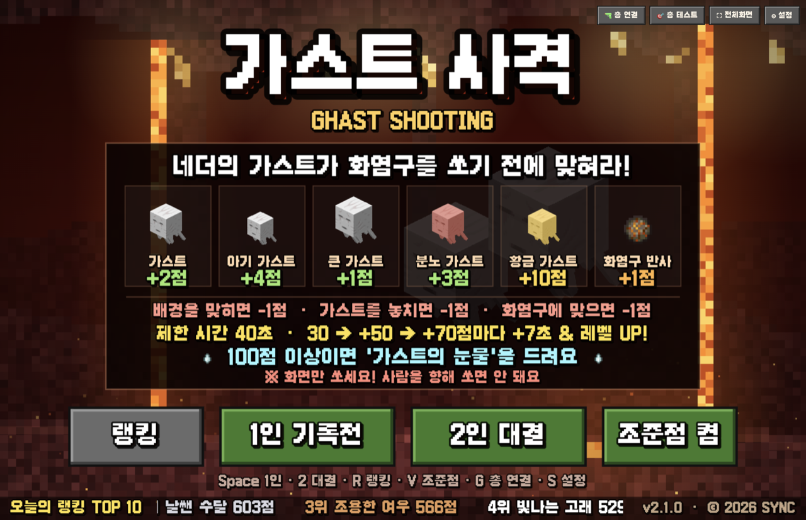

# 🔥 가스트 사격 (Ghast Shooting)

[](https://github.com/mg223080612-a11y/ghast/releases/latest)


> 네더에 나타난 가스트가 화염구를 쏘기 전에 라이트건으로 맞혀라!
> 학교 행사용 프로젝터 + 라이트건 사격 게임. 1인 기록전(온라인 랭킹)과 2인 대결을 지원합니다.



## 📥 다운로드 · 플레이

| 플랫폼 | 받을 파일 / 주소 | 받는 곳 | 비고 |
|---|---|---|---|
| 🌐 **온라인 (브라우저)** | https://ghast-shooting.gcinhak.workers.dev | [▶ 바로 플레이](https://ghast-shooting.gcinhak.workers.dev) | 설치 없음. Chrome 권장, **F** 로 전체화면 |
| 🪟 **Windows** (설치형) | `ghast-shooting-2.1.0-setup.exe` | [⬇ 최신 릴리스](https://github.com/mg223080612-a11y/ghast/releases/latest) | 설치하면 바탕화면에 **가스트 사격** 아이콘 |
| 🪟 **Windows** (휴대용) | `ghast-shooting-2.1.0-portable.exe` | [⬇ 최신 릴리스](https://github.com/mg223080612-a11y/ghast/releases/latest) | 설치 없이 파일 하나로 실행 (USB 용) |
| 🍎 **macOS** (애플 실리콘 M1~M4) | `ghast-shooting-2.1.0-mac-arm64.zip` | [⬇ 최신 릴리스](https://github.com/mg223080612-a11y/ghast/releases/latest) | 압축을 풀면 `Ghast Shooting.app` |
| 🍎 **macOS** (인텔) | `ghast-shooting-2.1.0-mac-x64.zip` | [⬇ 최신 릴리스](https://github.com/mg223080612-a11y/ghast/releases/latest) | 압축을 풀면 `Ghast Shooting.app` |

- **최신인지 확인:** 컴퓨터용 프로그램을 켜면 처음 화면 **맨 아래 띠 오른쪽(© 2026 SYNC 왼쪽)에 `v2.1.0`** 이 보여야 합니다. 그보다 낮은 버전(`v2.0.0` 등)이거나 버전이 안 보이면 옛 앱이니 [업데이트](#-업데이트-옛-앱에서-바꾸기)하세요.
- **처음 열 때 경고가 뜨면** (코드 서명 인증서가 없어서 뜨는 안내입니다)
  - Windows "Windows의 PC 보호" → **추가 정보 → 실행**
  - 맥 "악성 코드가 없음을 확인할 수 없습니다" → **완료** → 시스템 설정 → 개인정보 보호 및 보안 → 맨 아래 **그래도 열기**
- **랭킹 저장에는 인터넷이 필요합니다.** 인터넷 없이 하면 미리 받아 둔 예비 표로 **3판까지만** 나중에 저장됩니다.

---

## 📑 목차

- [게임 소개](#-게임-소개)
- [게임 방법](#-게임-방법)
- [조작법](#-조작법)
- [설치와 실행](#-설치와-실행)
- [업데이트 (옛 앱에서 바꾸기)](#-업데이트-옛-앱에서-바꾸기)
- [행사 운영 가이드](#-행사-운영-가이드)
- [성능 · 딜레이](#-성능--딜레이)
- [문제 해결](#-문제-해결)
- [개발자용](#-개발자용)

---

## 🎮 게임 소개

| 모드 | 설명 |
|---|---|
| **1인 기록전** | 닉네임(처음엔 '용감한 판다' 같은 형용사+동물 랜덤 이름, 🎲 로 다시 뽑거나 직접 입력)으로 혼자 플레이. 점수가 **온라인 랭킹**에 저장됩니다. |
| **2인 대결** | 총 2대로 둘이 동시에 플레이. 각자 점수를 따로 세고 이긴 사람에게 왕관 👑. 랭킹에는 저장하지 않습니다. |
| **토너먼트** | 3~32명. 참가자 이름을 넣으면 대진표가 무작위로 짜이고, 2인 대결로 한 경기씩 이긴 사람이 올라갑니다. 3·4위전, 우승 발표 화면. 랭킹에는 저장하지 않습니다. |
| **랭킹** | 난이도(**Easy · Normal · Hard**)마다 따로. **[날짜별]** 그날 0시부터의 TOP 10 (매일 새로 시작, ◀ 전날 / 다음 날 ▶). **[전체]** 모든 날짜를 합친 순위. 기록은 지워지지 않습니다. 2026-11 이전 기록은 모두 Normal 랭킹입니다. |

**특징**
- 🔫 라이트건(마우스 모드·조이스틱 모드), 마우스, 프로젝터 터치 센서 모두 지원
- 🎯 조준점(과녁) 켜기/끄기를 게임 안에서 선택
- ⚡ 저지연: 총 방아쇠를 1초에 약 250번 읽고, 맞히면 0.05초 만에 반응
- 🛡 인터넷이 끊겨도 게임은 계속되고, 기록은 보관했다가 연결되면 올립니다
- 💻 Windows · macOS 프로그램과 웹 버전이 같은 랭킹을 씁니다

**사용 장비 (행사 기준):** 노트북 + 엡손 EB-1480Fi/1485Fi 프로젝터 + **X-GUNNER(엑스거너) 무선 라이트건 2대** (센서·수신기 포함)

## 🕹 게임 방법

네더의 가스트를 화염구를 쏘기 전에 맞히세요. 기본 설정 기준이며, ⚙ 설정에서 바꿀 수 있습니다.

| 행동 | 점수 |
|---|---|
| 가스트 맞히기 | 종류마다 **+1 ~ +10점** |
| 화염구 맞히기(반사) | **+1점** |
| 배경(빈 곳)을 맞힘 | −1점 |
| 가스트를 놓침 | −1점 |
| 화염구에 맞음 | −1점 |

- 제한 시간 **40초**. 30 → +50 → +70점을 모을 때마다 **+7초 & 레벨 UP** (가스트가 빨라짐)
- **100점 이상**이면 '가스트의 눈물' 획득! (행사에서는 상품을 드립니다. 난이도마다 기준이 다름)
- ※ 화면만 쏘세요. 사람을 향해 쏘면 안 됩니다.

**난이도** — 닉네임 입력 창의 **[Easy] [Normal] [Hard]** 로 고릅니다 (총으로 쏴도 됨). 고른 값은 다음 사람에게도 그대로 갑니다.

| | Easy | Normal | Hard |
|---|---|---|---|
| 가스트 빠르기·등장 | 느리게 (×0.7) | ⚙ 설정 값 그대로 | 빠르게 (×1.35) |
| 가스트 크기 / 판정 여유 | 크게 (×1.2) / +10% | 설정 값 그대로 | 작게 (×0.85) / −5% |
| 감점 | 빈 곳·놓침 감점 없음, 화염구 피격만 | 설정 값 그대로 | 모두 두 배 |
| 가스트 종류 | 분노 가스트가 늦게·적게 | 지금까지와 같음 | 1레벨부터 아기·분노 가스트가 많이 |
| 가스트의 눈물 | 150점 | 100점 | 70점 |

Normal 이 예전 게임과 똑같고, Easy·Hard 는 설정 값에 위 배율을 곱합니다. 가스트의 눈물 기준은 ⚙ 설정에서 난이도마다 바꿀 수 있습니다.

**2인 대결 규칙**
- 가스트·화염구를 맞힌 사람이 점수를 받고, 빈 곳을 쏘면 **쏜 사람만** −1점
- 가스트를 놓치거나 화염구에 맞으면 **둘 다** 감점 (함께 지키는 화면)
- 보너스 시간·레벨 UP 은 **앞선 사람 점수** 기준, 100점 이상이면 각자 가스트의 눈물
- 결과 화면: 이긴 사람에게 왕관 · **새 대결**(이름 새로) / **다시 대결**(같은 이름) / **처음 화면**

**토너먼트 규칙**
- 처음 화면 **[토너먼트]** (키보드 **3**) → 참가 인원(3~32) · 한 경기 시간(기본 40초) · 3·4위전 · 난이도 → 이름 칸 입력 (빈 칸은 랜덤 닉네임, 같은 이름은 뒤에 숫자) → **대진표 만들기**
- 4·8·16·32명이 아니면 일부가 1라운드 **부전승** (양쪽에 고르게 나눔). 첫 경기 전까지 **[대진 다시 섞기]** 로 다시 뽑을 수 있습니다.
- 대진표에서 **위쪽 자리가 1P(하늘색), 아래쪽이 2P(분홍)**. 다음 경기 칸이 반짝입니다. **[경기 시작]** (또는 Space)
- 경기는 2인 대결과 같은 규칙이지만 **시간은 고정** (보너스 시간 없음, 레벨 UP 은 그대로). **동점이면 15초 연장전**을 승부가 날 때까지 반복합니다.
- 진행 순서: 앞 라운드부터 → 3·4위전 → 결승 → **우승 발표**(우승·준우승·3위·4위)
- 진행 상황은 컴퓨터에 저장됩니다. 경기 중에 처음 화면으로 나가거나 프로그램을 꺼도, 처음 화면 **[토너먼트 이어하기]** 로 그 경기부터 다시 합니다.
- 총 2대가 1P·2P 로 지정돼 있어야 경기를 시작할 수 있습니다 (아니면 총 연결 화면이 뜨고, 다 하면 **[대진표로 돌아가기]**).

## ⌨ 조작법

| 키 | 기능 |
|---|---|
| Space / Enter / 1 | 1인 기록전 시작 · 다음 사람 (총의 Space·Enter 버튼으로도 됨) |
| 2 | 2인 대결 시작 |
| 3 | 토너먼트 (진행 중이면 이어하기) |
| R | 랭킹 |
| V | 조준점(과녁) 켜기/끄기 (처음 화면에서만) |
| G | 총 연결 (2인 대결용 1P/2P 지정) |
| T | 총 조준 테스트 |
| P | 일시정지 |
| C | 처음 화면 (🏠 버튼과 같음, 게임 중이면 일시정지 후 한 번 더 확인) |
| Q | 처음 화면 (**게임 중에는 막힘** → P 로 멈춘 뒤 Q) |
| L | 렉 걸릴 때: 화질 가볍게 + 효과 줄이기 ↔ 보통 |
| F (프로그램은 F11 도) | 전체화면 ↔ 창 모드 |
| M | 소리 켜기/끄기 |
| S | 설정 (**게임 중에는 막힘**) |
| Alt+F4 (맥 Cmd+Q) | 프로그램 종료 |

> 엑스거너 총에는 q·s·w·a·d·5 같은 키보드 버튼이 있어서, 학생이 잘못 눌러도 게임이 끊기지 않도록 게임 중에는 Q·S 를 막아 두었습니다.

**조준점(과녁) 고르기:** 처음 화면 **[조준점 켬/끔]** 버튼(총으로 쏴도 됨) · **V** 키 · 닉네임 입력 창 **🎯 조준점** 버튼 · 설정(S) → 조준점('작은 십자'는 설정에서만). 고른 값은 저장되어 다음에 켜도 그대로이고, 게임 중에는 바꿀 수 없습니다.

## 💾 설치와 실행

### Windows
1. [최신 릴리스](https://github.com/mg223080612-a11y/ghast/releases/latest)에서 `-setup.exe`(설치형) 또는 `-portable.exe`(휴대용)를 받습니다.
2. 처음 실행할 때 **"Windows의 PC 보호"** 파란 창이 뜨면 **추가 정보 → 실행**.
3. 켜면 바로 **전체화면**으로 뜹니다. **F** 로 창 모드 전환, **Alt+F4** 로 종료. 켜져 있는 동안은 화면이 꺼지지 않습니다.

### macOS
1. [최신 릴리스](https://github.com/mg223080612-a11y/ghast/releases/latest)에서 zip 을 받습니다.
   - 애플 실리콘(M1~M4) 맥은 **꼭** `-mac-arm64.zip`, 인텔 맥은 `-mac-x64.zip` (확인: 사과 메뉴 → 이 Mac에 관하여 → 칩). 애플 실리콘 맥에 인텔용을 쓰면 Rosetta 로 느리게 켜지고, 총이 잡히는지도 확인되지 않았습니다.
2. zip 을 풀면 **`Ghast Shooting.app`** 이 나옵니다. 응용 프로그램 폴더로 옮깁니다.
   - 앱 파일 이름은 영어입니다. 한글 이름으로 만들면 맥에서 앱이 켜지자마자 꺼집니다 (`desktop/build.js` 참고). 게임 화면과 메뉴는 한글 그대로입니다.
3. 처음 열 때 "열리지 않음 … 악성 코드가 없음을 확인할 수 없습니다" 경고가 뜨면 (애플 개발자 인증서가 없어서 뜨는 안내입니다):
   1. 경고 창에서 **완료**
   2. **시스템 설정 → 개인정보 보호 및 보안** → 맨 아래 **그래도 열기** → 암호 입력
   - macOS 15(Sequoia) 부터는 예전처럼 '오른쪽 클릭 → 열기' 로는 열리지 않습니다.
   - 터미널이 편하면 대신: `xattr -dr com.apple.quarantine "/Applications/Ghast Shooting.app"` (받은 곳을 믿을 때만)
4. 종료 **Cmd+Q**, 전체화면 전환 **F**. 노치 있는 맥북도 화면 맨 위까지 꽉 채웁니다. 켜져 있는 동안은 화면이 꺼지지 않습니다.

### 온라인 (브라우저)
https://ghast-shooting.gcinhak.workers.dev 를 Chrome 으로 열고 **F** 로 전체화면. 설치가 필요 없고 늘 최신입니다 (화면에 버전은 표시되지 않습니다).

### 저장소 실행기 (`게임시작.bat` / `게임시작.command`)
이 저장소를 내려받은 컴퓨터에서 쓰는 방법입니다. 관리자 키가 `data/admin-key.txt` 에서 자동으로 채워집니다.
- **Windows `게임시작.bat`**: 더블클릭하면 게임이 전체화면으로 뜹니다. 작업표시줄의 "가스트 서버" 창은 닫지 마세요.
- **맥 `게임시작.command`**: Node.js 와 Chrome 이 필요합니다. 더블클릭하면 터미널 창에 게임 서버가 켜지고 Chrome 이 전체화면으로 열립니다 (Chrome 끄기: **Cmd+Q**).
  - 터미널 창은 게임하는 동안 닫지 마세요 (닫으면 서버가 꺼집니다). 서버가 켜져 있는 동안 화면이 꺼지지 않습니다.
  - 노치 있는 맥북은 Chrome 화면 맨 위에 얇은 검은 띠가 남습니다 (조준은 맞게 계산됨). 꽉 채우려면 맥용 앱을 쓰세요.
  - 더블클릭해도 안 열리면 위 3번처럼 **그래도 열기**, 또는 터미널에서 `chmod +x 게임시작.command`

### 알아 둘 것
- 랭킹은 웹 버전과 같은 온라인 랭킹에 저장됩니다. **인터넷에 연결해서 쓰세요.** 인터넷이 끊겨도 게임은 되고 기록은 모아 뒀다가 연결되면 보내지만, 미리 받아 둔 예비 표가 3장뿐이라 **오프라인으로는 3판까지만** 나중에 저장됩니다.
- 관리자 키는 프로그램에 들어 있지 않습니다. 기록을 지우려면 설정(S)의 관리자 키 칸에 직접 넣으세요.

## 🔄 업데이트 (옛 앱에서 바꾸기)

2026-11-07 부터 랭킹 서버가 '게임 시작 표'가 없는 기록을 받지 않아서, **2026-10-30 이전에 만든 옛 앱으로 한 판은 랭킹에 저장되지 않습니다.**
옛 앱(1.0.0)은 언제 만든 것인지 화면으로 구분할 수 없으니, **처음 화면에 버전이 안 보이면 무조건 바꿔 주세요.**

1. [최신 릴리스](https://github.com/mg223080612-a11y/ghast/releases/latest)에서 새 파일을 받습니다.
2. 예전 앱을 지웁니다.
   - Windows 설치형: 설정 → 앱 → **가스트 사격** → 제거 (portable 은 옛 exe 파일만 지우면 됨)
   - 맥: 응용 프로그램 폴더의 옛 `Ghast Shooting`·`Ghast Shooting (Aim)`·`(No Aim)` 앱을 휴지통으로. 같은 게임이 여러 개면 헷갈리고, 동시에 켤 수도 없습니다.
   - **설정은 이어집니다:** 총 보정·1P/2P 배정·조준점·게임 설정은 앱 밖 폴더에 저장되어 있어서 앱을 지워도 남고, 새 앱이 그대로 씁니다.
   - 아직 못 보낸 기록도 같은 곳에 남아 있어 새 앱이 이어서 보냅니다 (단, 표 없이 만든 기록은 서버가 받지 않습니다).
3. 새 앱을 설치하고 켜서 처음 화면 맨 아래 오른쪽에 `v2.1.0` 이 보이는지 확인합니다.
4. **인터넷에 연결한 채로 한 번 켜 둡니다.** 켜질 때 '게임 시작 표'를 미리 3장 받아 둡니다.

---

## 🎪 행사 운영 가이드

### 1. 프로젝터 연결
1. 노트북을 프로젝터에 HDMI 로 연결합니다.
2. **Win + P → "복제"** 를 고릅니다. (확장 모드면 총 커서가 엉뚱한 화면으로 갈 수 있어요)
   - 맥: **시스템 설정 → 디스플레이** 에서 프로젝터를 내장 디스플레이의 **미러링**으로 둡니다.
3. 프로젝터 화면이 벽·화이트보드에 반듯하게 나오도록 위치와 초점을 맞춥니다.
4. 프로젝터의 **손가락 터치(인터랙티브) 기능은 꺼 두세요.** 적외선을 써서 총 센서와 겹칠 수 있습니다.

### 2. 센서 4개 달기 (엑스거너)
센서 배치는 두 가지 중 하나를 고릅니다. **사각형(Square)** 을 권장합니다.

```
 사각형(Square)              다이아몬드(Diamond)
   ●         ●                     ●
 ┌───────────────┐          ┌───────────────┐
 │   투사 화면     │        ● │   투사 화면     │ ●
 └───────────────┘          └───────────────┘
   ●         ●                     ●
 위·아래 변에 2개씩            네 변의 한가운데
```

1. 투사된 화면 테두리에 딱 붙여 양면테이프로 고정합니다. (학생이 건드리면 조준이 틀어지니 단단히)
2. 센서 USB 를 노트북이나 USB 충전기에 꽂습니다. **PC 에 연결하지 않아도 전원만 들어오면 작동합니다.**
3. 휴대폰 카메라로 비춰서 4개 모두 불빛이 보이는지 확인합니다.
4. 총에서 배치를 맞춥니다: 사각형 **Q + E + D** / 다이아몬드 **Q + E + A** (총의 q·e·a·d 버튼)
5. 창문 햇빛이 화면에 들면 조준이 흔들립니다. **커튼을 치세요.**

### 3. 총 연결 (엑스거너)
1. 총에 18650 배터리를 넣고 **전원 스위치**를 켭니다. (충전은 USB 케이블로)
2. **USB 수신기**를 노트북에 꽂습니다.
   - 반응이 없으면: 총과 수신기의 **DIP 스위치(덮개 안 작은 스위치)** 가 똑같은지 확인합니다.
3. **연사(Rapid Fire) 스위치를 꼭 끕니다.** 켜져 있으면 방아쇠 한 번에 7번 클릭되어 빗나감 감점이 쏟아집니다.
4. 마우스(라이트건) 모드인지 확인합니다. 조준하면 커서가 따라오고 방아쇠가 클릭이 되어야 합니다.
   - 아니면: **Space + 5 + 조이스틱 위**
5. 화면 비율은 **Space + D (16:9)** 로 맞춥니다.
6. 학생이 설 자리를 바닥에 테이프로 표시하고, **그 자리에서 캘리브레이션**합니다.
   1. **Space + Start** → 일시정지 모드
   2. **방아쇠 1번** → 캘리브레이션 시작
   3. **가운데 → 위 → 아래 → 왼쪽 → 오른쪽** 순서로 화면 끝을 겨눠 쏩니다
   4. 진동 1번 → 자동 저장 끝
   - 프로젝터·센서 위치나 배치(사각형/다이아몬드)를 바꾸면 다시 합니다.

### 4. 총 2대 연결 (2인 대결)
총 2대가 둘 다 마우스로 들어오면 컴퓨터가 어느 총이 쐈는지 구분하지 못합니다.
그래서 **두 총을 조이스틱 모드**로 바꾸면 게임이 각 총을 따로 읽습니다. (1인 기록전도 이 모드로 그대로 됩니다)

1. **센서는 한 세트(4개)만** 답니다. 두 총이 같은 센서를 봅니다. 나머지 한 세트는 예비.
2. 두 총의 **수신기를 모두** 노트북에 꽂습니다.
   - 총과 수신기는 짝끼리 **DIP 스위치를 같게**, 두 쌍끼리는 **서로 다르게** 맞춥니다. (같으면 서로 간섭)
3. 두 총 모두 **조이스틱 모드**로: 총에서 **Space + 5 + 조이스틱 왼쪽**
4. 게임 처음 화면에서 **G** (또는 오른쪽 위 🔫 총 연결)
   1. 총의 방아쇠를 한 번씩 당기면 목록에 "총 1", "총 2" 가 나타납니다.
   2. **1P 지정** → 1P 가 될 총의 방아쇠 → 자동으로 2P 지정으로 넘어감 → 2P 총의 방아쇠
   3. 두 총을 움직여 하늘색(1P)·분홍(2P) 조준점이 따라다니는지 확인
   4. 조준점이 거꾸로 움직이면 **좌우 반전 / 상하 반전**, 안 움직이면 **조준 축** 을 눌러 바꿔 봅니다
   5. 지정은 저장되어 다음에 켜도 그대로입니다
5. 처음 화면 **2인 대결** (또는 키보드 2) → 이름 두 개 (비우면 1P·2P) → 시작

### 5. 게임 켜기
1. 컴퓨터용 프로그램(Windows **가스트 사격** / 맥 `Ghast Shooting.app`)을 켭니다. 저장소 실행기를 쓰면 `게임시작.bat` (맥 `게임시작.command`).
2. 처음 화면에서 **T** (또는 오른쪽 위 🎯 총 테스트) 를 눌러 **총 조준 테스트**를 합니다.
   - 9개 표적을 쏴서 점이 초록색이면 바로 게임해도 됩니다.
   - 빨간색이면 3번의 캘리브레이션을 다시 하세요.
3. 한 판 해 보고 결과 화면에 "오늘 ○위 · 전체 ○위" 가 나오면 랭킹 저장까지 정상입니다.

### 6. 진행
- 진행요원이 **게임 시작 → 닉네임 입력(키보드) → Enter** 로 시작합니다.
- 조준점 켬/끔은 다음 사람에게도 그대로 갑니다. 처음 화면에서 빗나간 총알이 [조준점] 버튼에 맞아도 바뀌므로, 시작할 때 닉네임 창의 🎯 버튼에서 한 번 확인하세요. (1인 기록전 랭킹에는 조준점을 켜고 한 기록과 끄고 한 기록이 섞입니다)
- 결과 화면은 3초 동안 버튼이 잠겨 있습니다. (계속 쏘는 총알이 버튼을 잘못 누르지 않게)
- 100점 이상이면 "가스트의 눈물 획득!" → 밀키스를 줍니다. (기준 점수는 ⚙ 설정에서 변경)
- **1인 기록전이 끝나면 '이름 쏘기' 판**이 뜹니다. 키보드와 같은 배치(1~0 / QWERTYUIOP / ASDFGHJKL / ZXCVBNM)의 알파벳·숫자를 총으로 쏴서 랭킹에 남길 이름(최대 6글자)을 넣고 **등록**. 처음 2초는 잠겨 있고(끝까지 쏘던 총알 방지), 한 글자 쏠 때마다 5초가 다시 채워지며 5초 동안 안 쏘면 자동 등록됩니다. 아무것도 안 쏘거나 **건너뛰기** 를 누르면 게임할 때의 닉네임으로 남습니다.
- **다음 사람** (또는 Space) 을 누르면 새 닉네임을 입력합니다.
- **다시 하기** 를 누르면 새 랜덤 닉네임이 자동으로 배정되어 바로 한 판 더 합니다. (2인 대결의 **다시 대결** 은 같은 이름 그대로)

### 맥에서 총·프로젝터 연결
(2026-11-04 애플 실리콘 맥북 + 엑스거너 1대로 시험)
- **프로젝터**: 맥북 Pro 14·16형은 HDMI 단자가 있으니 HDMI 케이블로 바로 꽂습니다 (맥북 에어는 어댑터 필요). HDMI 겸용 USB-C 어댑터(안에 USB 허브가 있는 것)는 꽂는 단자에 따라 USB 허브가 1~4초마다 끊긴 적이 있고, 거기 꽂은 수신기도 같이 끊겼습니다. 어댑터를 써야 하면 다른 단자로 옮겨 보세요.
- **수신기**: 맥북 USB-C 단자에 USB-C→USB-A 젠더로 **직접** 꽂습니다. 총 2대면 수신기를 서로 다른 단자에 꽂습니다.
- **총 모드**: 조이스틱 모드(Space + 5 + 조이스틱 왼쪽). 맥에서도 다른 프로그램 없이 게임패드로 잡힙니다 (엑스거너 설정 프로그램은 Windows 전용이지만 게임에는 필요 없음).
- **'총 1' 이 나오게 하기**: 게임을 켜고 **게임 창을 맨 앞에 둔 채** 방아쇠를 한 번 당깁니다. 다른 창(터미널·Finder·시스템 설정 등)을 누르면 게임 창이 뒤로 가서 총 입력이 멈춥니다 → 게임 화면을 한 번 클릭하세요.
- 그래도 안 나오면 수신기가 맥에 잡혔는지 봅니다: 사과 메뉴 → 이 Mac에 관하여 → 추가 정보 → 시스템 리포트 → **USB** 에 `XGUNNER-P1` 이 있어야 합니다. 없으면 수신기를 다시 꽂거나 다른 단자·젠더로 바꿉니다.
- 행사 전에 G(총 연결)에서 '총 1'·'총 2', T(총 테스트)로 조준을 확인하세요. 총 2대 동시 사용과 프로젝터 앞 조준은 아직 맥에서 시험하지 않았습니다.
- 총 지정·조준 보정은 컴퓨터(그리고 앱/크롬)마다 따로 저장됩니다. 윈도우에서 해 둔 설정은 맥으로 옮겨지지 않으니 맥에서 한 번 더 합니다.
- 총을 마우스 모드로 쓰면, 화면 맨 위 끝을 겨누고 있을 때 맥 메뉴 막대가 내려올 수 있습니다. 조이스틱 모드를 권장합니다.

---

## ⚡ 성능 · 딜레이

### 딜레이(반응 지연) 줄이기 — 행사 전 체크
게임 쪽은 이미 최대한 빠르게 맞춰 두었습니다 (총 방아쇠를 1초에 약 250번 읽기, 맞히면 0.05초 만에 '팡', 배경은 한 번만 그리고 매 프레임에는 가스트·효과만 그리기, 저지연 화면 모드). 남은 지연은 대부분 **노트북·프로젝터 설정**에서 생깁니다.

**노트북 (Windows)**
1. **충전기를 꽂습니다.** 배터리로 돌리면 그래픽 성능이 크게 떨어집니다.
2. 설정 → 시스템 → 전원 및 배터리 → 전원 모드 → **최고 성능**
3. **Win + P → "두 번째 화면만"** (진행요원이 노트북 화면을 안 봐도 된다면). "복제"는 화면 두 개를 함께 그려 느려질 수 있습니다.
4. 다른 프로그램(카카오톡, 다른 크롬 탭, 영상, 녹화 프로그램)을 끕니다.
5. (웹·`게임시작.bat` 으로 할 때) Chrome 주소창 `chrome://settings/system` → **그래픽 가속(하드웨어 가속) 켜기**

**노트북 (맥)**
1. **충전기를 꽂습니다.**
2. 시스템 설정 → 배터리 → **저전력 모드: 안 함**
3. 프로젝터는 **미러링**으로, 다른 프로그램(카카오톡, 다른 크롬 탭, 영상)은 끕니다.

**프로젝터 (엡손)** — 메뉴에 있으면
- 화질 보정 기능(프레임 보간, 노이즈 감소, 세부 강조 등)을 **끕니다.** 이런 기능은 화면을 한 번 더 처리하느라 지연이 생깁니다.
- 영상 처리 / 이미지 처리 항목이 있으면 **빠르게(Fast)**

**총 (엑스거너)**
- 배터리를 **완충**합니다. 배터리가 약하면 무선 반응이 늦어집니다.
- 수신기를 USB 연장선으로 **총 쪽(화면 앞)** 가까이 둡니다.

**게임 설정 (⚙)**
- **FPS 표시**를 켜면 왼쪽 아래에 속도가 나옵니다. 50 이상(초록)이면 충분, 30 아래(빨강)면 버벅임
- 버벅이면 **화질 → 가볍게**

### 렉 걸릴 때 — 순서대로
1. **그냥 기다리기**: 3초 넘게 버벅이면 게임이 **자동으로** 한 단계씩 가볍게 바꿉니다 (보통 → 가볍게 → 가볍게 + 효과 줄이기). 화면 위에 "렉 방지: 화면을 가볍게 바꿨어요" 가 뜹니다.
2. **L 키**: 바로 '가볍게 + 효과 줄이기' (한 번 더 누르면 보통으로)
3. **충전기 꽂기**, 전원 모드 **최고 성능**
4. 다른 프로그램 끄기 (카카오톡, 크롬 다른 탭, 영상)
5. 그래도 안 되면 게임을 닫고 다시 실행 (랭킹·설정은 그대로 남아 있음)

> 화면이 멈춘 것처럼 보여도 게임은 오류가 나도 멈추지 않게 만들어 두었습니다.
> 브라우저에서 정말로 화면이 안 움직이면 Ctrl+F5 (새로 고침, 맥 크롬은 Cmd+Shift+R).

### 컴퓨터 부담 (측정값, 프로젝터 크기 1920×1200 기준)

| 항목 | 측정 | 판단 |
|---|---|---|
| 한 프레임 계산 | 평균 약 1ms, 가장 바쁠 때 약 2ms (60fps 기준 한도 16.7ms) | 여유 많음 |
| 총 읽기 (1초 250번) | CPU 1개의 약 0.2% | 거의 없음 |
| 프로그램 메모리 | 8판 연속 후에도 약 4MB 그대로 | 새는 곳 없음 |
| 글자 그림 저장 | 최대 약 24MB 로 제한 | 일정 |
| 게임 파일 크기 | 전체 약 160KB (그림 30KB) | 가벼움 |

크롬 창 하나를 켜 둔 정도의 부담이라 노트북이 과열·과부하될 일은 거의 없습니다. 다만 게임은 계속 화면을 그리므로 **배터리는 빨리 닳습니다 → 충전기를 꽂아 두세요.**

## 🛠 문제 해결

| 증상 | 확인할 것 |
|---|---|
| 랭킹에 기록이 안 올라감 | 처음 화면에 `v2.1.0` 이 보이는지 (안 보이면 [업데이트](#-업데이트-옛-앱에서-바꾸기)), 인터넷 연결 |
| 결과 화면에 "이 PC에 보관했어요" | 인터넷 끊김. 기록은 노트북에 보관됐다가 연결되면 자동으로 올라갑니다 (오프라인은 3판까지) |
| 처음 실행이 막힘 | Windows: **추가 정보 → 실행** / 맥: 시스템 설정 → 개인정보 보호 및 보안 → **그래도 열기** |
| 총을 쏴도 반응이 없음 | 총 전원·배터리, 수신기 연결, DIP 스위치 일치, 센서 전원, 라이트건 모드(Space + 5 + 조이스틱 위) |
| 한 번 쐈는데 여러 번 맞음·감점 | **연사(Rapid Fire) 스위치 끄기** |
| 조준과 맞는 자리가 다름 | T 로 조준 테스트 → 어긋나면 캘리브레이션 다시 (Space + Start → 방아쇠) |
| 커서가 덜덜 떨림 | 햇빛 차단, 프로젝터 터치 기능 끄기, 센서 4개 다 켜졌는지 |
| 총 연결 화면에 총이 안 나옴 | 조이스틱 모드(Space + 5 + 조이스틱 왼쪽)인지, 게임 창을 앞에 두고 방아쇠를 한 번 당겼는지, 수신기 2개 다 꽂혔는지. 맥은 [맥에서 총·프로젝터 연결](#맥에서-총프로젝터-연결) |
| (맥) 수신기·총이 자꾸 끊김 | HDMI 겸용 USB-C 어댑터의 USB 단자에 꽂았다면 수신기를 맥북에 젠더로 직접 꽂기. 어댑터는 다른 단자로 옮기기 |
| 2인 대결에서 한 총만 쏴짐 | G → 1P·2P 지정이 둘 다 '지정됨' 인지, 두 쌍의 DIP 스위치가 서로 다른지 |
| 조준점이 거꾸로·안 움직임 | G → 좌우/상하 반전, 조준 축 바꾸기 |
| 한 총만 조준이 위·아래(옆)로 어긋남 | G → **1P/2P 조준 보정** → 깜빡이는 표적 5개를 그 총으로 차례로 쏘기 → T 로 확인. 지우려면 보정 화면의 **보정 지우기** |
| 한 총만 방아쇠가 자꾸 안 먹음 | 그 총의 **Rapid Fire(연사) 스위치가 꺼져 있는지** 확인 (연사는 게임이 막아요) |
| 커서가 다른 화면에 감 | Win + P → 복제 (맥: 시스템 설정 → 디스플레이 → 미러링) |
| 이상한 닉네임이 랭킹에 있음 | S → 랭킹 관리 → 삭제 (관리자 키 필요) |
| 소리가 안 남 | M 키, 노트북 음량, 프로젝터 음량 |
| 화면이 꺼짐 | 컴퓨터용 프로그램과 `게임시작.command` 는 켜져 있는 동안 화면이 꺼지지 않게 합니다. `게임시작.bat`·웹으로 할 때는 Windows 설정 → 전원 → 화면 끄기를 '안 함' 으로 (행사 동안만) |

---

## 👩‍💻 개발자용

### 기술 스택
| 영역 | 사용 |
|---|---|
| 게임 | HTML5 Canvas + 순수 JavaScript (프레임워크 없음), 갈무리 11 Bold 픽셀 폰트(`fonts/`) |
| 입력 | Pointer Events(마우스·터치·마우스 모드 총), Gamepad API(조이스틱 모드 총) |
| 컴퓨터용 프로그램 | Electron 44 + electron-builder (Windows NSIS·portable, macOS zip) |
| 랭킹 서버 | Cloudflare Workers + D1 (`worker.js`, `migrations/`) — 접시 사격(clay)과 같은 서버를 씁니다 |
| 배포 | GitHub Actions (`.github/workflows/release.yml`) → GitHub Releases |

### 폴더 구조
```
ghast/
├── index.html · style.css · game.js   게임 (웹·앱 공통)
├── tournament-core.js                 토너먼트 대진표 계산 (화면과 무관, 테스트 있음)
├── tournament.js                      토너먼트 화면·진행
├── tests/                             자동 테스트 (npm test)
├── assets/ · fonts/                   그림·폰트
├── desktop/                           Electron (main.js · preload.js · build.js · icon.png)
├── worker.js · migrations/ · wrangler.toml · limits.json   랭킹 서버
├── serve.cjs                          로컬 게임 서버 (게임시작.bat/.command 가 사용)
├── 게임시작.bat · 게임시작.command      행사용 실행기
├── .github/workflows/release.yml      Windows·맥 빌드 + 릴리스
└── docs/                              README 그림
```

### 로컬에서 실행
```bash
npm install
npm run app          # 컴퓨터용 프로그램(Electron)으로 바로 실행
node serve.cjs       # 브라우저용: http://localhost:5190
npm test             # 토너먼트 대진표 계산 테스트
```

### 컴퓨터용 프로그램 빌드
```bash
npm run build:exe    # Windows 설치형·휴대용 exe
npm run build:mac    # 맥 zip (arm64·x64) — 맥에서만 됨
```
결과는 `release/` 폴더. 게임 파일을 고친 뒤에는 다시 만들어야 반영됩니다.

### 새 버전 배포하기
GitHub 의 윈도우·맥 컴퓨터가 exe 2개 + 맥 zip 2개를 만들어 Releases 에 올립니다.
1. `package.json` 의 `version` 을 올립니다 (예: `2.0.1`). 파일 이름과 처음 화면의 `v2.0.1` 이 이 값을 따릅니다.
2. 커밋·push 한 뒤 같은 이름의 태그를 올립니다: `git tag v2.0.1` → `git push origin v2.0.1`
3. 10분쯤 뒤 Releases 에 `v2.0.1` 이 **Latest** 로 생깁니다. 팀원 안내 주소(`/releases/latest`)는 그대로입니다.
- 태그와 `package.json` 버전이 다르면 빌드가 멈춥니다.
- 태그 없이 시험으로 만들기만: Actions → 컴퓨터용 프로그램 배포 → Run workflow (Artifacts 에서 받기)
- 워크플로 파일을 바꾸는 push 는 토큰에 `workflow` 권한이 필요합니다 (SSH 로 push 하거나 `gh auth refresh -s workflow`).

### 랭킹 서버 (Cloudflare)
- 게임 수정 후 온라인 반영: `npx wrangler deploy`
- DB 테이블 만들기·고치기: `npx wrangler d1 migrations apply ghast-db --remote`
- 관리자 키 바꾸기: `npx wrangler secret put ADMIN_KEY` 후 `data/admin-key.txt` 도 같은 값으로
- **가짜 기록 막기 (게임 시작 표)**: 게임을 시작할 때 서버가 시작 시각에 서명한 표를 주고, 기록을 올릴 때 그 표를 확인합니다 (서명이 맞는지 · 한 번만 쓰는지 · 걸린 시간에 비해 점수가 말이 되는지). 서명 키: `npx wrangler secret put PLAY_SECRET` → 아무 긴 글자(32자 이상). 운영에는 2026-11-07 부터 켜져 있습니다. 인터넷이 끊긴 채로 한 판을 해도, 그 전에 미리 받아 둔 표(최대 3장)로 나중에 올라갑니다.
- 로컬 테스트: `.dev.vars` 에 `PLAY_SECRET=...` 를 적고 `npx wrangler dev --local` (`.dev.vars` 는 git·배포에서 빠짐)
- 점수 상한(가짜 점수 차단): 지금은 없음. 필요하면 `wrangler.toml` 에 `[vars] MAX_SCORE = "1000"` 을 적고 배포
- **난이도별 랭킹**: 서버의 `game` 값으로 나눕니다 — `ghast`(Normal, 예전 기록 전부) · `ghasteasy` · `ghasthard`. 허용 목록은 `limits.json` 이라 DB 를 바꿀 필요는 없고 `npx wrangler deploy` 만 하면 됩니다. 배포 전에는 Easy·Hard 기록이 "모르는 게임입니다" 로 거절됩니다. 접시 사격 저장소의 `docs/limits.json` 도 같은 내용으로 맞춰 두세요.
- `data/` 폴더(행사 기록·관리자 키)는 git 에 올리지 않습니다.

---

© 2026 SYNC
